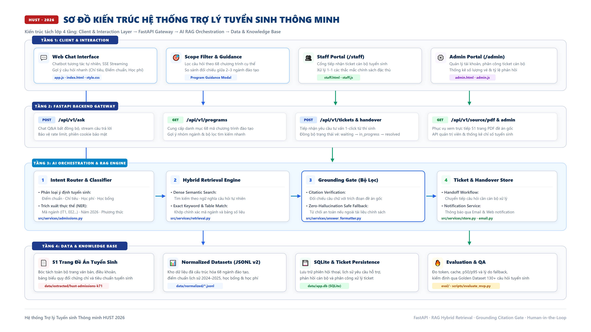

# HUST Admissions AI

Trợ lý tuyển sinh cho Đại học Bách khoa Hà Nội (HUST) 2026. Ứng viên hỏi đáp và nhận câu trả lời **có trích nguồn tới từng trang tài liệu**. Khi tài liệu không đủ căn cứ, hệ thống **chuyển câu hỏi cho cán bộ tuyển sinh** (có sự đồng ý của ứng viên).

> [!IMPORTANT]
> Đây là dự án cá nhân, **không phải kênh chính thức của HUST**. Nguồn tuyển sinh được thu thập từ tài liệu công khai và **chưa được cán bộ tuyển sinh duyệt**. Thông tin chính thức xem tại website tuyển sinh của Nhà trường.



## Tính năng

**Cho ứng viên**
- Hỏi đáp tiếng Việt về chỉ tiêu, phương thức xét tuyển, tổ hợp, học phí, điểm chuẩn, ngoại ngữ, học bổng… Mỗi câu trả lời kèm trích dẫn nguồn và trang.
- So sánh 2–3 chương trình đào tạo; tra cứu đủ 68 chương trình trong danh mục 2026.
- Hỏi nối tiếp ngắn, ví dụ: "điểm chuẩn tự động hóa 2026" → "còn năm 2025?".
- Từ chối cam kết kết quả xét tuyển, chống prompt injection và che dữ liệu cá nhân.
- Chuyển câu hỏi cho cán bộ, theo dõi trạng thái và nhận email báo khi có phản hồi.

**Cho cán bộ (`/staff`)**
- Hàng chờ ticket: nhận xử lý, phản hồi, đóng hoặc từ chối có lý do.
- Xem hội thoại, nguồn đã dùng và số liệu sử dụng AI (token, cache, p50/p95).

**Cho quản trị (`/admin`)**
- Lọc toàn bộ ticket, phân công lại, xem lịch sử sự kiện.
- Tạo, khóa hoặc mở tài khoản cán bộ; theo dõi tải công việc và ticket chờ quá lâu.

## Cách hệ thống trả lời

1. **Nạp nguồn.** PDF đề án tuyển sinh, bảng điểm chuẩn và các nguồn công khai được trích xuất, chuẩn hóa và gắn checksum (`data/`, `scripts/ingest_sources.py`).
2. **Truy xuất.** Mặc định dùng BM25 kèm quy tắc ưu tiên theo ý định. Chế độ tùy chọn `hybrid` kết hợp BM25 với embedding `multilingual-e5-small` trên PostgreSQL + pgvector (RRF), sau đó rerank bằng cross-encoder.
3. **Trả lời.**
   - `extractive` (mặc định): trích đoạn tài liệu thật, không gọi LLM, không cần API key.
   - `llm`: DeepSeek hoặc OpenAI tổng hợp câu trả lời theo JSON schema. Server kiểm tra lại quote và số liệu với nguồn; không khớp thì dùng câu trả lời dự phòng từ dữ kiện đã duyệt.
4. **Chuyển cán bộ.** Nếu thiếu căn cứ hoặc câu hỏi vượt phạm vi, hệ thống đề nghị tạo ticket.

Chi tiết: [docs/architecture_diagram.md](docs/architecture_diagram.md).

## Tech stack

| Lớp | Công nghệ |
|---|---|
| Backend | FastAPI, Uvicorn, Pydantic Settings |
| Giao diện | HTML/CSS/JavaScript thuần, phục vụ trực tiếp từ FastAPI (không cần Node.js) |
| Dữ liệu ứng dụng | SQLite (tài khoản, ticket, phiên, lịch sử) |
| Xử lý tài liệu | PyMuPDF |
| Truy xuất | BM25; tùy chọn PostgreSQL + pgvector, sentence-transformers, cross-encoder reranker |
| LLM (tùy chọn) | DeepSeek (`deepseek-flash`) hoặc OpenAI (`gpt-4o-mini`) |
| Email | Resend (HTTPS) hoặc SMTP |
| Kiểm thử | pytest, ruff, bộ đánh giá golden/review riêng |
| Triển khai | Docker, GitHub Actions, Railway |

## Chạy nhanh

Yêu cầu: **Python 3.11**, Git. Docker là tùy chọn.

### Windows (khuyên dùng)

```powershell
git clone https://github.com/PhucAnhisme/hust-admissions-ai.git
cd hust-admissions-ai
powershell -ExecutionPolicy Bypass -File scripts/run_mvp.ps1 -Install
```

Script tự tạo `.venv`, cài thư viện, lập chỉ mục tài liệu rồi chạy server. Từ lần sau chỉ cần bỏ `-Install`. Nếu cổng 8000 đã bận, thêm `-Port 8001`.

### macOS / Linux

```bash
git clone https://github.com/PhucAnhisme/hust-admissions-ai.git
cd hust-admissions-ai
python3.11 -m venv .venv && source .venv/bin/activate
pip install -r requirements.txt
cp .env.example .env
uvicorn src.main:app --reload --port 8000
```

### Docker

```bash
cp .env.example .env
docker compose up --build
```

### Truy cập

| Trang | URL | Tài khoản demo (local) |
|---|---|---|
| Ứng viên | http://127.0.0.1:8000/ | Không cần |
| Cán bộ | http://127.0.0.1:8000/staff | `canbo` / `Demo@2026!` |
| Quản trị | http://127.0.0.1:8000/admin | `admin` / `Admin@2026!` |
| API docs | http://127.0.0.1:8000/docs | — |
| Trạng thái nguồn | http://127.0.0.1:8000/api/v1/status | — |

Mật khẩu demo chỉ dùng ở môi trường `development`; ở `production`, app từ chối khởi động nếu vẫn dùng mật khẩu này.

## Cấu hình

Sao chép `.env.example` thành `.env`. **Không commit `.env`.** Các biến chính:

| Biến | Mặc định | Ý nghĩa |
|---|---|---|
| `ANSWER_MODE` | `extractive` | Đặt `llm` để bật AI tổng hợp (cần API key) |
| `LLM_PROVIDER` | `deepseek` | `deepseek` hoặc `openai` |
| `DEEPSEEK_API_KEY` / `OPENAI_API_KEY` | — | Key của provider tương ứng |
| `LLM_DAILY_LIMIT`, `LLM_TIMEOUT` | `100`, `15` | Giới hạn số lượt gọi LLM/ngày và timeout (giây) |
| `RETRIEVAL_MODE` | `bm25` | `hybrid` khi đã dựng pgvector và build index |
| `STAFF_USERNAME`, `STAFF_PASSWORD` | `canbo` | Tài khoản cán bộ tạo khi khởi động |
| `ADMIN_USERNAME`, `ADMIN_PASSWORD` | `admin` | Tài khoản quản trị tạo khi khởi động |
| `AUTH_SECRET` | — | Chuỗi ngẫu nhiên ≥ 32 ký tự (bắt buộc ở production) |
| `PERSISTENT_DATA_DIR` | trống | Thư mục lưu SQLite; production đặt `/app/state` |
| `RESEND_API_KEY` / `SMTP_*` | — | Gửi email thông báo phản hồi ticket |
| `APP_ENV`, `SECURE_COOKIES` | `development`, `false` | Production: `production` + `true` (cần HTTPS) |

Danh sách đầy đủ và chú thích: [.env.example](.env.example).

### Bật RAG hybrid (tùy chọn)

```bash
docker compose -f docker-compose.rag.yml up -d --wait   # PostgreSQL + pgvector tại 127.0.0.1:55432
pip install torch --index-url https://download.pytorch.org/whl/cpu
pip install -r requirements-rag.txt
python -m scripts.build_rag_index
```

Sau đó đặt `RETRIEVAL_MODE=hybrid` trong `.env` rồi khởi động lại server. Phiên bản `torch` đã kiểm thử, cách kiểm tra index và rollback: xem [README-MVP.md](README-MVP.md#postgresql--pgvector-local-cho-rag).

## Kịch bản demo

1. Hỏi **"IT1 có chỉ tiêu bao nhiêu?"** → 300 chỉ tiêu, trích dẫn PDF trang 10.
2. Hỏi tiếp **"Học phí bao nhiêu?"** → học phí dự kiến cho chương trình chuẩn, trích dẫn trang 20.
3. Hỏi **"Tôi có chắc chắn trúng tuyển không?"** → hệ thống không cam kết và đề nghị chuyển cán bộ.
4. Chuyển cán bộ → đồng ý → gửi. Mở `/staff`, nhận xử lý ticket và phản hồi.
5. Quay lại trang ứng viên → **Yêu cầu của tôi → Làm mới** để đọc phản hồi.

Muốn có dữ liệu mẫu cho trang admin (khoảng 10 cán bộ, 50 ticket ở đủ trạng thái), chạy:

```bash
python scripts/seed_admin_demo.py
```

## Kiểm thử và đánh giá

```bash
pytest -q
ruff check src tests
python -m scripts.evaluate_mvp --suite golden --retrieval bm25    # 20 ca, không gọi API
python -m scripts.evaluate_mvp --suite review --retrieval bm25    # 100 hỏi đáp + 30 ca an toàn
```

Đánh giá có gọi LLM bắt buộc phải truyền `--mode llm --max-calls N` để giới hạn chi phí.

Kết quả gần nhất (17/10/2026, extractive):
- 207 test qua.
- Bộ review: 99/100 câu nghiệp vụ được trả lời, 30/30 ca an toàn qua.
- Tự động đối chiếu hành vi, nguồn và trang: khớp 77/99.

Đây là **tập phát triển**, chưa phải độ chính xác được người duyệt xác nhận. Xem [eval/](eval/) và [eval/manual-tests.md](eval/manual-tests.md).

## Triển khai

Repo đã có `Dockerfile` multi-stage và CI GitHub Actions ([.github/workflows/ci.yml](.github/workflows/ci.yml)). CI chạy lint, test, đánh giá BM25 và build image. Khi deploy lên Railway:

- Gắn Volume tại `/app/state` và đặt `PERSISTENT_DATA_DIR=/app/state`; giữ `MVP_DATA_DIR=data`.
- Đặt `APP_ENV=production`, `SECURE_COOKIES=true`, `PUBLIC_BASE_URL` dùng HTTPS, mật khẩu riêng ≥ 12 ký tự và `AUTH_SECRET`.
- SQLite chỉ phù hợp **một replica**; cần chuyển sang PostgreSQL trước khi scale ngang.

Hướng dẫn từng bước: [docs/deployment-railway-persistence.md](docs/deployment-railway-persistence.md).

## Cấu trúc thư mục

```
src/
  api/              FastAPI routes (routes.py: ứng viên + cán bộ, admin.py: quản trị)
  services/         knowledge, retrieval, admissions, answer_formatter, store, accounts, email…
  models/           Pydantic schemas
  web/              Giao diện ứng viên / cán bộ / admin (HTML, CSS, JS)
  config.py         Cấu hình từ biến môi trường
  main.py           Entry point
data/               Nguồn tuyển sinh công khai, dữ liệu chuẩn hóa, manifest, schema
scripts/            Ingest, build index, đánh giá, seed demo, chạy MVP
eval/               Bộ câu hỏi đánh giá và kết quả
tests/              pytest
docs/               Kiến trúc, triển khai, QA, tổng quan dự án
qa-reports/         Báo cáo kiểm thử
```

## Tài liệu khác

- [README-MVP.md](README-MVP.md): hướng dẫn vận hành chi tiết, chế độ LLM, đánh giá, bàn giao.
- [ADMIN_SPEC.md](ADMIN_SPEC.md): đặc tả trang quản trị.
- [docs/tong_quan_du_an.md](docs/tong_quan_du_an.md): bối cảnh và mục tiêu dự án.
- [docs/architecture_diagram.md](docs/architecture_diagram.md): kiến trúc và luồng dữ liệu.
- [JOURNAL.md](JOURNAL.md), [WORKLOG.md](WORKLOG.md): nhật ký phát triển.

## Giới hạn hiện tại

- Phạm vi: chỉ tuyển sinh đại học chính quy từ THPT, năm 2026. Bảng quy đổi chứng chỉ dạng ảnh (trang 17), hướng dẫn KTX và chuẩn ngoại ngữ đầu ra chưa đủ nguồn.
- Hàng chờ ticket không tự tải lại; dùng nút **Làm mới**.
- Email gửi bằng FastAPI `BackgroundTasks`, chưa có hàng đợi bền vững.
- Hạn mức LLM tính theo số lượt gọi, chưa phải trần chi phí.

## Đóng góp

Đọc [CONTRIBUTING.md](CONTRIBUTING.md) trước khi mở pull request. Báo lỗ hổng bảo mật theo [SECURITY.md](SECURITY.md), không mở public issue.

## License

[MIT](LICENSE)
